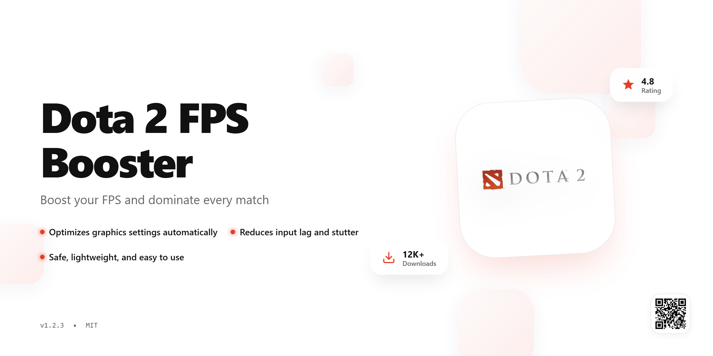

# 🎯 Dota 2 FPS Booster — Raw Performance Enhancer for Windows

### 💻 PowerShell Installer

   

---

Dota 2 FPS Booster is a focused performance toolkit that squeezes real frames out of Valve's engine without touching the game process itself. It ships launch flag presets, validated config tweaks, a whitelist-driven background process killer, shader cache purges, and netgraph tuning — all applied through sanctioned config files and Windows settings, all reversible from a snapshot. No overlays, no injection, no bloat: just measurable 1% low gains and smoother teamfights on the hardware you already own.

## ✅ Requirements

- Windows 10 or Windows 11
- PowerShell 5.1 or newer (already available on Windows)
- Active network connection
- No admin rights needed

## Features

**Launch flag presets** — a validated set of Steam boot flags that trims startup overhead and pushes the engine toward performance mode. Applied in one click, reverted just as fast.
- **Config tuner** — writes backed-up, hardware-tier-aware values straight into the game's own config files. Nothing gets overwritten blind; originals are snapshotted first.
- **Background process suspender** — whitelist-based suspension of the apps eating CPU while you queue. They come back automatically the moment the client closes.
- **Shader cache purge** — clears stale compiled shaders after major patches and triggers a clean rebuild, killing the mid-fight hitch that follows every update.
- **Netgraph tuning** — keeps network stats legible without cluttering your HUD, so you read ping and loss at a glance instead of squinting.
- **Frametime readout** — a lightweight topmost counter with 1% low tracking. Zero injection, under 0.3 ms render cost.
- **One-click rollback** — every change is snapshotted before it lands. If a tweak misbehaves, restore and move on.

Raw FPS gain, no overlays fighting your client, no nonsense. Just the tuning that matters, done safely and undone easily.

## How it works

Every gain comes from four layers working together, in order, the moment you hit Apply.

**1. Launch layer.** The tool builds a validated Steam launch string for Dota 2 — engine flags that skip the intro, pin the right render device and stop the client from booting background bloat it doesn't need mid-match. Conflicting or deprecated flags get rejected before they ever reach Steam.

**2. Config layer.** It writes a backed-up `autoexec.cfg` and `video.txt` from validated cvars only, tuned to your hardware tier. Shadow quality, borderless mode and netgraph readability are set once and reapplied automatically if a patch silently reverts them.

**3. Process layer.** While you're queued or in a match, a whitelist-based suspender pauses the apps you allow it to touch — browsers, chat clients, launchers — then brings them back the instant Dota 2 exits. A power plan switch keeps the machine from throttling mid-teamfight.

**4. Cache layer.** Stale shader cache gets purged and rebuilt clean, killing the mid-fight hitch that shows up after every major patch.

The result is raw FPS and steadier frametime — no overlays, no injection, nothing touching the game process. Every change is snapshotted first, so a single click rolls the whole thing back.

## Supported Games

Dota 2 FPS Booster is built around Dota 2's engine and only Dota 2's engine. That's the point — every launch flag, config value and shader cache path is matched to how Source 2 actually boots the client, not guessed from a generic Windows tweak list.

**Primary target**

- **Dota 2 (Steam,)** — fully supported. Launch flags, autoexec values, netgraph tuning, shader cache purge and background process suspension are all validated against the live client.
- **Dota 2 (DX12 / Vulkan)** — supported. Config and launch tuning apply; shader cache handling follows the active render path.

**Verified works**

- **Borderless Windowed and Exclusive Fullscreen** — both modes covered, with the config writer setting the correct one per your setup.
- **Ranked, Turbo and Custom lobbies** — the process killer and netgraph tuning run regardless of match mode.
- **Hybrid-graphics laptops** — the config writer picks the discrete GPU render device automatically.

**Not targeted**

- **Dota 2 under Proton / Linux** — the process layer and power plan switcher are Windows-only. Don't expect parity there.
- **Steam Deck** — out of scope; the tuning surface doesn't map cleanly.
- **Other Source 2 titles** — Deadlock and friends are a different config tree. This tool won't touch them.

One game, tuned properly. If you're queuing anything other than Dota 2, this booster stays out of the way.

## Configuration

Everything lives in one portable window. No services, no registry sprawl — just a folder, a config file, and a handful of toggles you actually control.

### Profiles

Three built-in presets ship with the booster:

- **Balanced** — the default. Safe launch flags, sane autoexec values, shader purge on a weekly timer. Meant to be invisible.
- **Max Throughput** — pushes launch options harder, trims background processes aggressively, and re-tunes netgraph density. Best for casual and Turbo queues.
- **Low-End Rescue** — dials back shadow and particle cvars, forces borderless windowed, and enables the RAM trim guard. Built for laptops and older GPUs.

Custom profiles let you fork any preset and save your own combination. Profiles are stored as plain files next to the booster, so you can copy them between machines or share the good ones with your stack.

### Launch flags

The Launch Flag Validator builds and checks your Steam launch string. It merges with what's already there instead of blindly overwriting, refuses deprecated entries, and warns on conflicting pairs before they ever reach Steam. A single click applies the result; a second click rolls it back to the prior string.

### Config writes

All cvars go through a validated allowlist and are written into a backed-up autoexec. The booster snapshots your existing config before the first write and after every change, so any single tweak can be reverted on its own — no need to nuke the whole profile. If Valve silently resets a value after a patch, the Patch Reset Detector flags it and offers a one-click reapply.

### Background process handling

Whitelist-first by design. Nothing gets suspended unless you add it. The watcher pauses whitelisted apps while a match is live and brings them back the moment Dota 2 exits — even if the booster window is closed mid-match. The startup bloat auditor is read-only and just lists what's stealing CPU before you queue.

### Shader cache and timers

The cache cleaner ships with a manual purge button and an optional weekly schedule. After a major Dota patch, let it finish a full rebuild once before you judge the frametime. The power plan switcher only flips while the game runs and restores your previous plan on exit.

### Overlay

The frametime readout is a topmost window, not an injection. Hotkeys bind toggling per-metric; the update rate is adjustable for high-refresh monitors. If you see more than half a millisecond of overlay cost, drop the update rate before you blame the tune.

### Where to start

If you're setting up for the first time: take a snapshot, pick Balanced, apply, and play a match. If frametime gets worse, open the config diff viewer, revert the culprit, and move on. That's the loop — small, reversible changes with a clean undo at every step.

## FAQ

**Does this trigger VAC?**

No. Dota 2 FPS Booster stays entirely outside the injection space. It writes only Valve-documented config values, builds validated Steam launch flags, and toggles Windows settings. No DLL is loaded into `.exe`, no game memory is read or written, and no render pipeline is hooked. The netgraph and FPS readouts are plain Windows topmost windows — zero injection, zero hooks.

**Will it survive the next Dota 2 patch?**

Almost always. Valve occasionally reverts cvars after major updates, so the tool detects reset values on launch and reapplies your saved profile automatically. If a patch ever breaks a preset, the safe-boot path launches Dota 2 with every tweak disabled so you can queue while a fix ships.

**Is the source open?**

The build ships as a single portable executable for players who just want to run it. Development happens in the open through issues and pull requests, and the release channel is always the compiled build.

**Do I need administrator rights?**

Only for the power-plan and Game Mode modules. Launch flags, config tuning, background process suspension, and shader cache purging all run in user mode. Skip those two modules and you can run the executable unelevated.

**Can I stack it with other performance tools?**

Don't. Two tools writing `autoexec.cfg` or Steam launch flags will fight each other and produce garbage configs. Pick one workflow; if you switch, restore from a snapshot first so you start from a clean baseline.

**Q:** Does it work on laptops with hybrid graphics?
**A:** Yes. The video config writer detects discrete versus integrated GPUs and points the client at the right render device.

**Q:** What happens if I close the tool while background apps are suspended?
**A:** They resume automatically. A small watchdog process cleans up suspended apps even if the main window dies unexpectedly.

**Q:** Can I revert one tweak without rolling back everything?
**A:** Yes. The config diff viewer lets you restore individual values from any snapshot instead of a full rollback.

**Q:** Why did my frametime get worse after enabling the readout?
**A:** It shouldn't — the readout budget stays under 0.3 ms. If you see more, switch the readout to the minimal theme; the high-contrast transparency pass costs extra on some GPUs.

**Q:** Does it touch game files or the anti-tamper surface?
**A:** No game files are modified and nothing is written outside your own config directory, snapshots folder, and standard Windows settings. Every write is logged and reversible from a snapshot.

**Q:** Will this run on a potato rig?
**A:** That's the point. The low-end cvar preset plus background suspension is tuned for mid-range and older hardware chasing stable 1% lows, not benchmark screenshots.

## Disclaimer

This build is a performance tool, not a gameplay advantage. Every module works strictly through Valve-documented config files, Steam launch flags, Windows power settings, and whitelisted background process control. Nothing is injected into `.exe`, no memory is read or written, no DLLs are hooked, and the overlay is a standard topmost window — not an injected renderer.

It will not alter matchmaking, hero stats, vision, input timing, or anything the server validates. If you're looking for something that changes how the game plays rather than how it runs, this isn't it — and that's by design.

Results scale with your hardware. Frametime gains shown on mid-range rigs won't mirror on a high-end setup pinned at its refresh cap, and no config on earth fixes a weak GPU. Take a snapshot before you apply anything; every write is reversible from a named rollback point if a tweak misbehaves on your specific build.

Valve patches can reset cvars or deprecate launch flags. The Patch Reset Detector flags drift and updates ship within days of major releases, but a brand-new patch may briefly leave a module stale until it's re-validated. Safe Mode boots Dota 2 with all tweaks disabled whenever you need a clean baseline.

You are responsible for the changes you apply to your own machine. Run it on hardware you own, keep the tool in its own folder, and don't mix it with other config writers that both touch `autoexec.cfg` — pick one or you'll get conflicts no snapshot can untangle.